# Rotorbound

An FPV drone game for Windows (and the browser). You're a freelance drone pilot in a busy city with moving cranes, an elevated train, traffic, alleys, a stunt park, a stadium and a theme park to fly through.

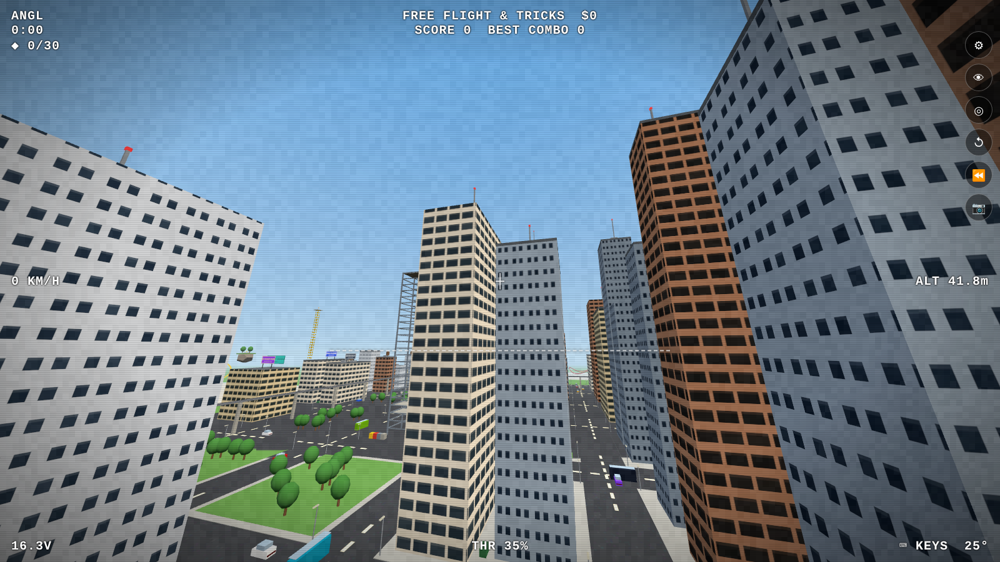

## Play

- **Windows:** grab the latest **Rotorbound-vX-windows.zip** from [Releases](https://github.com/kefirman9000/rotorbound/releases/latest), unzip it, and double-click **`Rotorbound.bat`**.
- **Browser:** https://kefirman9000.github.io/rotorbound/ (Xbox controllers work there too)

The game opens in its own window and works offline. Each launch checks GitHub for a newer version and **only updates if you click Yes**.

## Maps

- **Rotor City:** a big sprawling city with a stunt park, a stadium, the Skyfair theme park, a river and an elevated train.
- **Neon Canyons:** a compact 380 m vertical city built for FPV flow, with three flight bands (street canyons, facades and skybridges, rooftops up to 140 m). It has a neon crossroads under hanging signs, a scaffolding tower with a crane, a west–east rooftop chain, an alley grid with fire escapes and vertical shafts, an elevated highway with a broken middle, and a canal with two bridges on the south edge. Golden-hour sun shadows.

- **Neon Canyons** now also has a **subway** under the streets (station dive from the plaza, a moving train), a rotating neon **spinner tower**, a **bridge that collapses** as you cross, a **car-wash tunnel** with spinning brushes, a **water tower** to climb, rooftop pools and gardens, and wind turbines.
- **Port Yard:** container canyons, moving gantry cranes, ship-to-shore cranes and two cargo ships you can fly through.
- **Abandoned Factory:** a dark hall with catwalks, conveyors, skylights and an overhead crane, plus smokestacks, silos, a conveyor tube and a pitch-black tunnel. The headlight is always on.
- **Canyon Valley:** real terrain with a river, a waterfall with a cave behind it, a dam spillway, suspension and rope bridges and a rock arch.
- **Ski Resort:** a snowy mountain with a chairlift, a gondola, a ski jump, slalom flags and a lodge.
- **Mall & Airport:** a three-floor atrium with escalators, a food court and fountain, an airport terminal with a baggage carousel, jet bridges, parked and taxiing planes, a control tower and a parking deck.

Switch maps in **Settings → Map**, and the weather in **Settings → Weather** (map default, clear, fog, rain with lightning, or snow).

## What's in it

- **Races:** 6 tracks in Rotor City (City Loop, Parking Garage, Bridge Run, Rooftop Run, Stunt Park Slalom, Skyfair Park) 3 in Neon Canyons (Crossroads Sprint, Canyon Run, Sky Chain) and 2 on each of the five new maps. A ghost of your best lap flies alongside you, and the top 10 laps on your PC are kept for each track.
- **Courier jobs:** pick up a package on one rooftop and land it on another before par time. Heavier packages make the drone sluggish, and wind gusts get stronger up high.
- **Free flight & tricks:** flips, rolls, power loops, corkscrews, dives, proximity runs and gaps (rings, fans, under bridges, through the tunnel, the stadium tunnel, the skeleton tower and the Ferris wheel) chain into combos. Combos pay **double in the Stunt Park**.
- **30 hidden tokens** around each map, worth $50 each. Find them all and a **secret vault** opens somewhere on the map, worth $5,000.
- **Time-trial segments:** short timed sections on every map (fly through the start, beat your best at the finish).
- **Things to break:** traffic cones, cardboard boxes, barrels and glass panes scatter or shatter when you hit them, without crashing you.
- **Live skies:** helicopters and a blimp carrying bonus orbs, night fireworks, searchlights, fog drifting through alleys, rain with lightning and snow.
- **Forgiving where it should be:** light poles, cables, wires, AC units, solar panels, trees and scaffolding poles are *soft*, so clipping them wobbles you instead of ending the run. Walls, pillars and building faces are still hard. After a crash you respawn at your last safe spot, or at the last gate in a race, with a 2-second hover assist. Prefer a full restart? Change it in Settings.
- **Flow features:** real ramps and rising roads (the Neon Canyons highway on-ramp, the stair street up to the waterfront terrace, kicker ramps in the Stunt Park), overhanging towers, rooftop-gap jumps, steam vents and wet, reflective streets.
- **The world:** a skeleton tower under construction with tower cranes swinging their hooks, an elevated train looping the city, traffic, alleys with fire escapes, rooftop billboards and water towers, a riverside tunnel, the Stunt Park (giant rings, spinning fans, a half-pipe, dive towers, floating islands), a stadium, and the Skyfair theme park (Ferris wheel, roller coaster, drop tower).
- **Time of day:** day, sunset, night or a full cycle, with lit windows, neon, street lamps, car headlights and a drone headlight.
- **Replay** of your last 30 seconds with 4 camera angles, and a **photo mode** that saves PNGs to your Downloads folder.

## Screenshots

### New maps (v0.7)

| | |
|---|---|
|  | 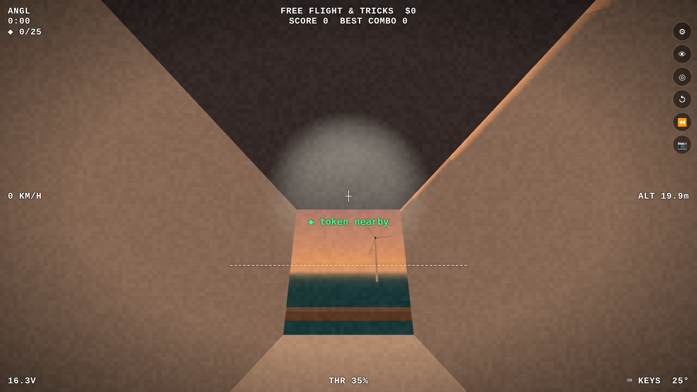 |
|  | 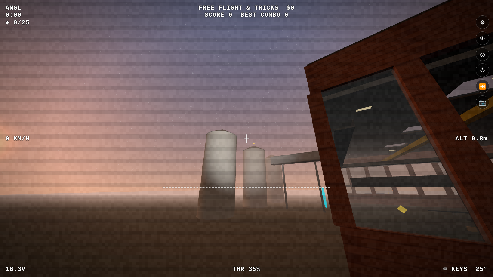 |
|  |  |
| 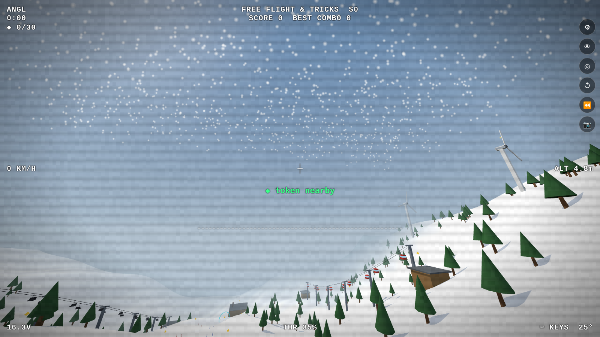 |  |
| 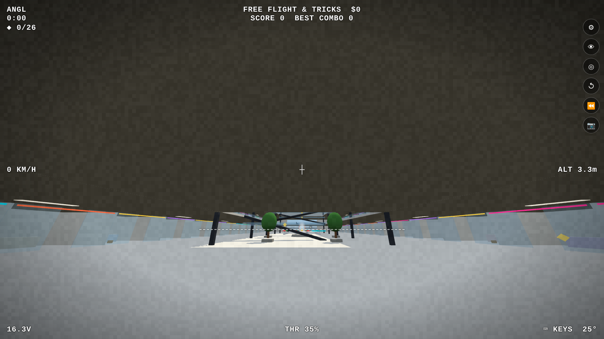 |  |
| 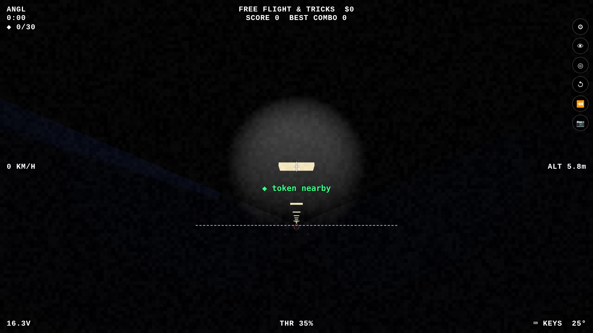 | 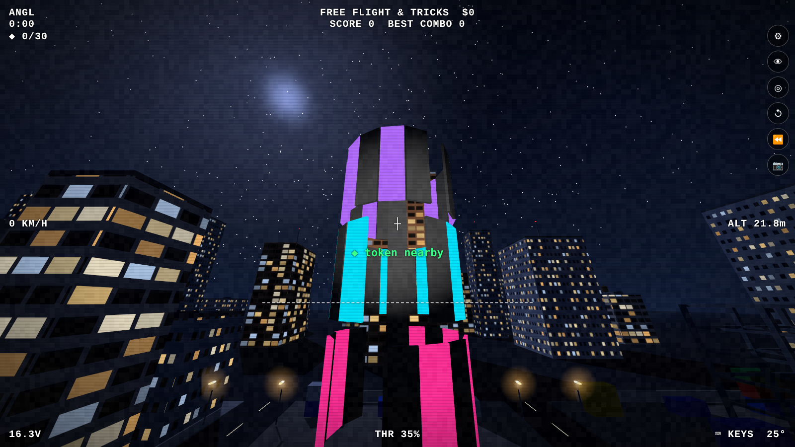 |
|  | |

### Neon Canyons

| | |
|---|---|
|  | 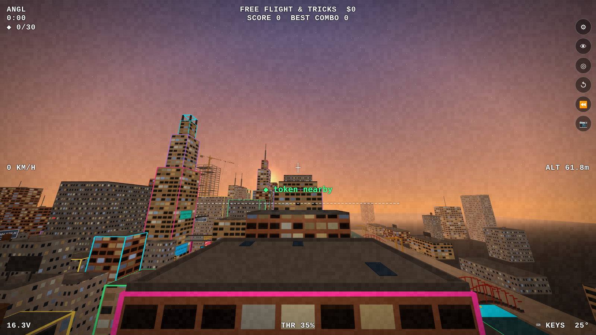 |
|  |  |
| 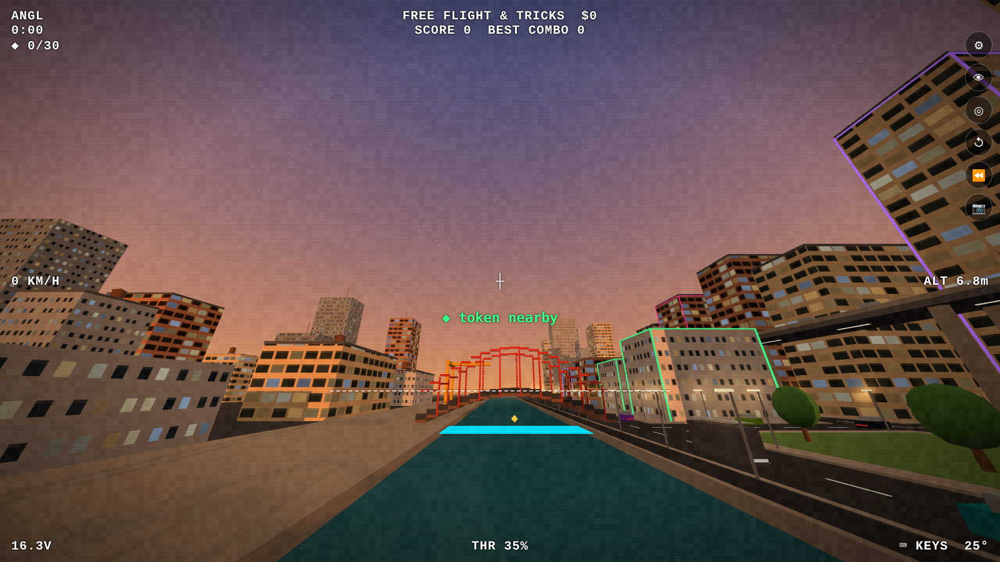 | 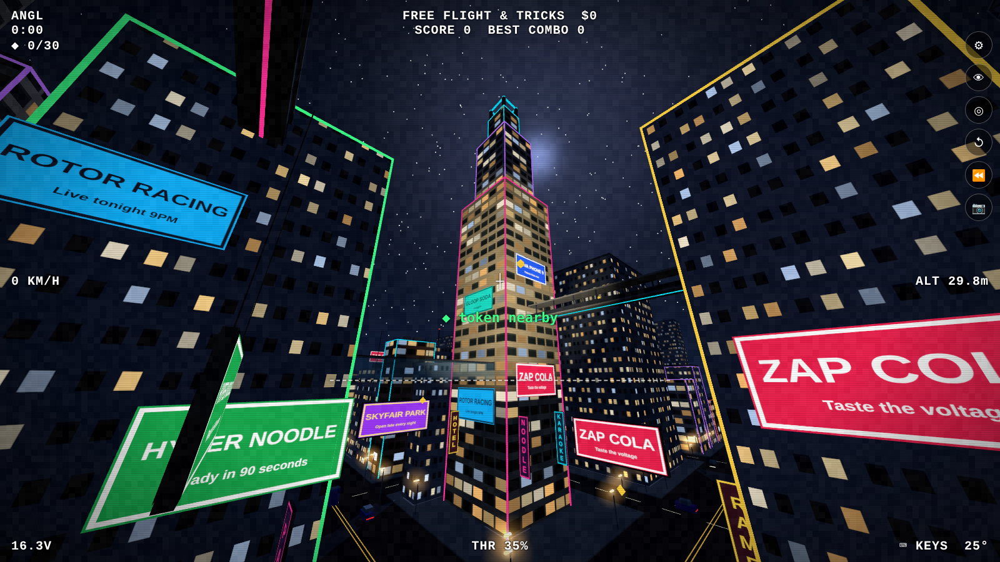 |
|  |  |
|  |  |

### Rotor City

| | |
|---|---|
| 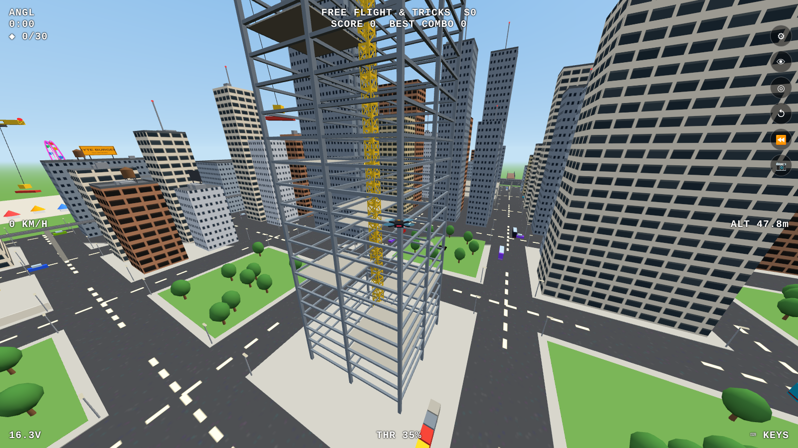 | 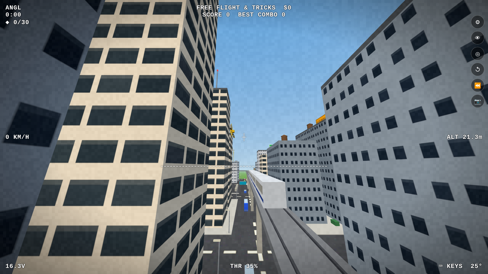 |
|  |  |
| 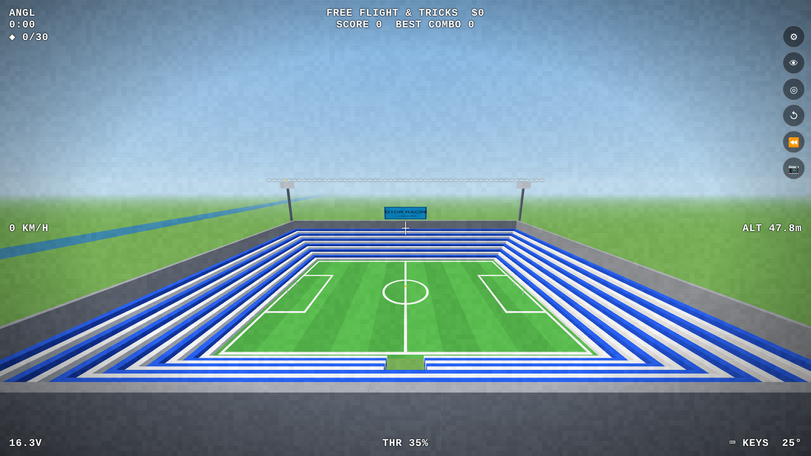 |  |
|  | 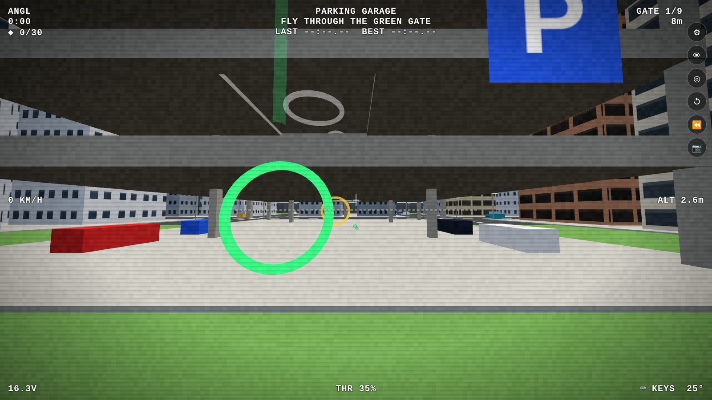 |
|  | 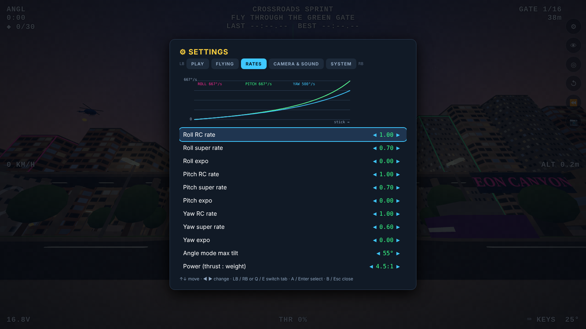 |

## Controls & feel

- **Rates:** Betaflight-style RC rate, super rate and expo for roll, pitch and yaw, with a live curve preview in Settings.
- **Throttle:** mid and expo settings, plus three styles (trigger, centre = hover, or full-range stick for RC radios).
- **Flight modes:** Angle (self-level), **Horizon** (levels at centre stick, flips at full stick) and Acro. Optional **altitude hold** in Angle and Horizon.
- **Controller setup:** remap every axis and button, set a deadzone for each stick, and calibrate (for drifting sticks or a USB RC radio). Open it from Settings → 🎮 Controller setup.
- **Turtle mode:** crashed upside down? Hold **LT** (or G) to flip back over and keep flying.
- **Rewind:** hold **B** (or Backspace) to rewind through the last 30 seconds.
- **Feel:** the motors spool with a little lag and the drone wobbles in its own prop wash. Xbox impulse triggers rumble with motor load.
- **Racing line:** a faint line traces your best lap on each track.

## Xbox controller

Plug it in by USB or pair it over Bluetooth, then press any button.

| Button | Action |
|---|---|
| RT | Throttle (or use the left stick, set in Settings) |
| Left stick ↔ | Yaw |
| Right stick | Pitch / roll |
| A | Start / respawn after a crash |
| B | Tap: FPV ⇄ chase camera · Hold: rewind |
| Y | Flight mode: Angle → Horizon → Acro |
| X | Restart lap / new courier job |
| LB / RB | Camera uptilt − / + |
| L3 (click left stick) | Replay last 30 seconds |
| R3 (click right stick) | Photo mode |
| LT (hold, after a crash) | Turtle flip |
| View | Reset drone |
| Menu | Settings / pause (navigate with the D-pad) |

The keyboard and touch controls are listed on the start screen.

## Roadmap

1. ✅ Flight physics, FPV camera, controls, city
2. ✅ More tracks + ghost replay, courier jobs, time of day
3. ✅ Busy world, stunt park, stadium, theme park, tricks, tokens, replay, photo mode
4. ✅ Neon Canyons map
4b. ✅ Five more maps, set pieces, weather, secret vaults, segments and destructibles
5. Garage (frames, motors, props, batteries) to spend your earnings
6. Film gigs + defense nights
7. Signal range, sound and polish
8. Online leaderboards (needs a small server)

## Credits

Built with [three.js](https://threejs.org) (MIT license, included in `lib/`).

## ❤ Support

If you enjoy Rotorbound, you can support development through **[GitHub Sponsors](https://github.com/sponsors/kefirman9000)**.
